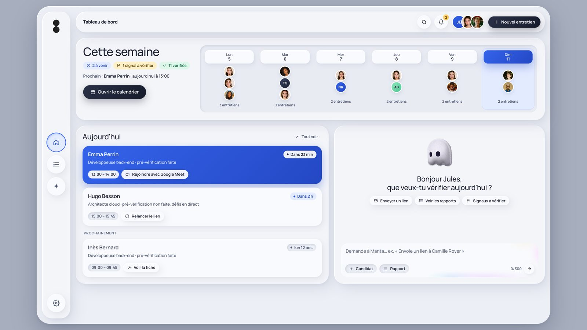
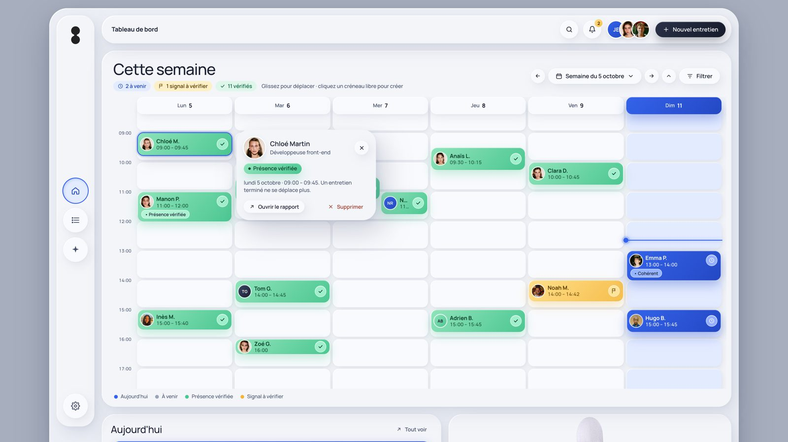
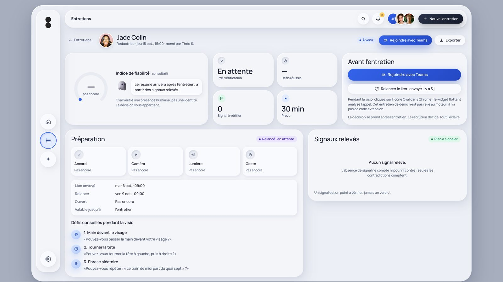
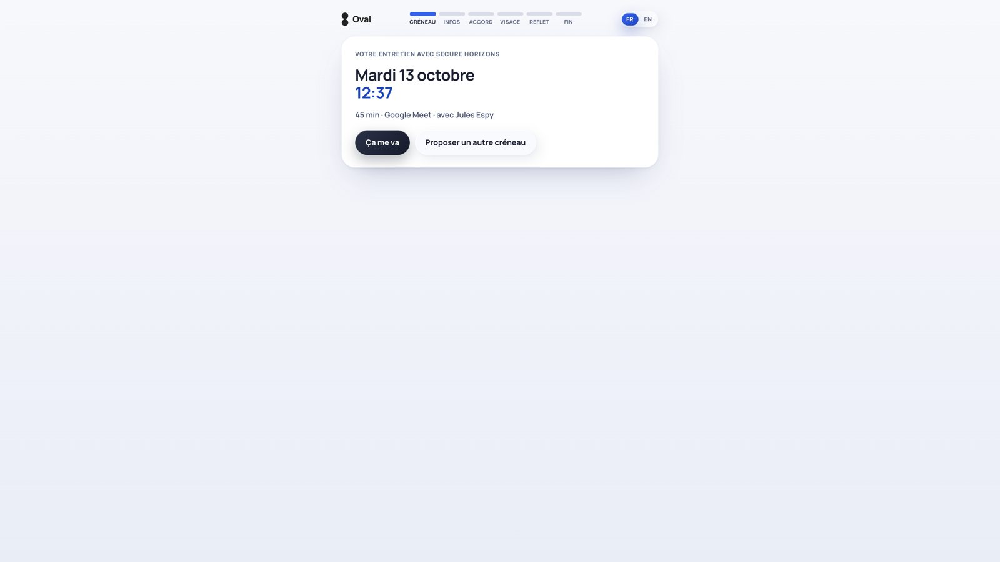
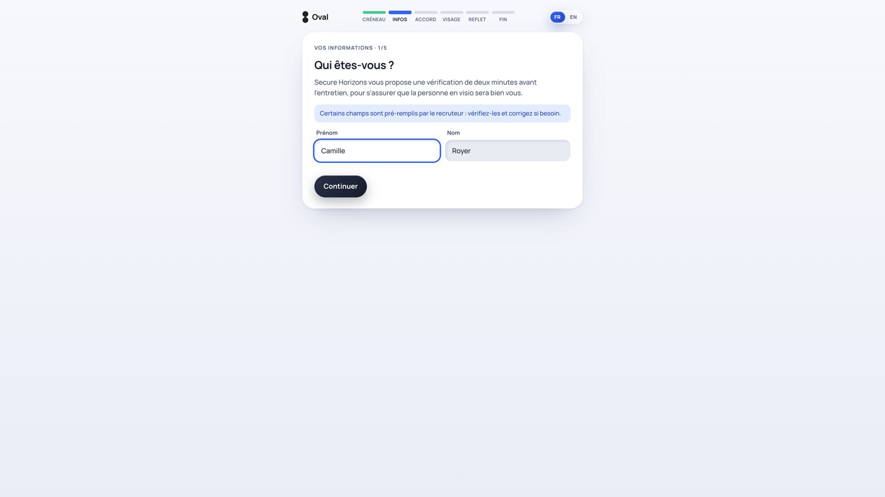
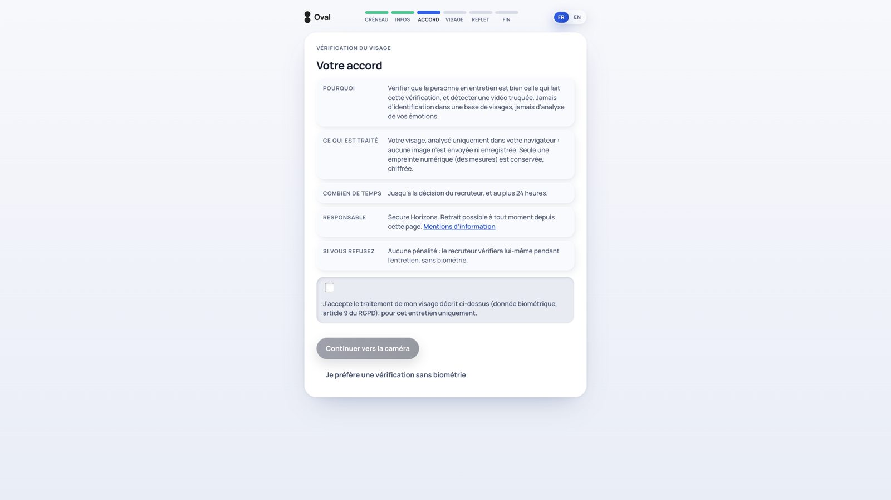
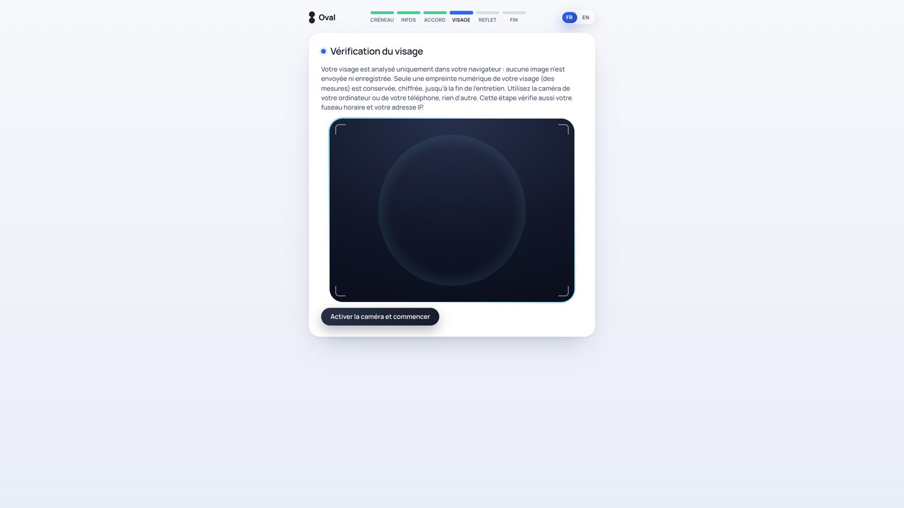
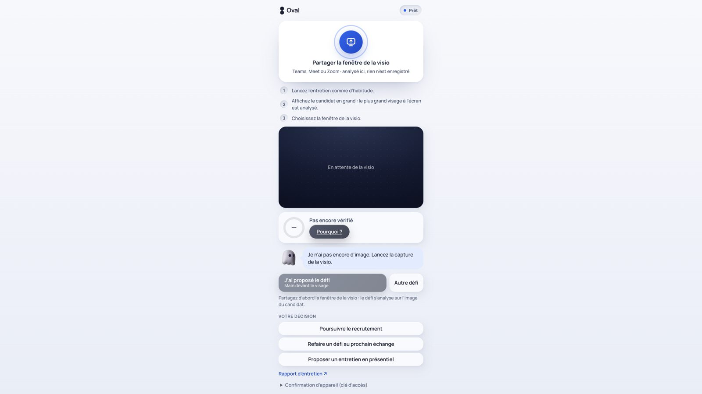

# Oval — guide pour le jury

> **Oval vérifie qu'un humain réel, et le bon, est présent dans une visio de recrutement.** Une pré-vérification de deux minutes avant l'entretien, un widget pendant la visio, un rapport pour le recruteur. Tout est analysé dans le navigateur, aucune vidéo ne sort. Le recruteur décide, l'outil éclaire.

Ce guide explique comment tester Oval en cinq minutes, sans rien installer, puis comment le lancer sur votre machine si vous voulez aller plus loin.

---

## 1. Tester en ligne, sans installation

| Quoi | Adresse |
|---|---|
| **Dashboard recruteur** | https://oval-moteur.onrender.com/app/ |
| Site du moteur (pages candidat, panneau, rapports) | https://oval-moteur.onrender.com |
| Dépôt GitHub | https://github.com/oansellem-dev/Hackaton-deepfake |

Deux choses à savoir :
- Le service est hébergé sur un palier gratuit : **la première ouverture peut prendre jusqu'à une minute** si le serveur dormait. Ensuite tout est fluide.
- Les données de démo du dashboard (31 entretiens, photos, rapports) sont stockées dans votre navigateur : chaque visiteur a son propre jeu, rien n'est partagé. Le bouton « Réinitialiser la démo » dans Réglages → Démo remet tout à zéro.

### Parcours conseillé (5 minutes)

**Étape 1 · Le dashboard (2 min)**

1. Ouvrez https://oval-moteur.onrender.com/app/. Vous arrivez sur l'accueil : la semaine en cours, les entretiens du jour, l'assistant Manta.
2. Cliquez sur **« Ouvrir le calendrier »** : vue semaine, glissez un rendez-vous pour le déplacer, tirez sa poignée basse pour changer sa durée, cliquez une case vide pour en créer un, cliquez une personne pour ouvrir sa fiche.
3. Menu de gauche, deuxième icône : **Entretiens**. Filtrez par onglet (À venir, Signal à vérifier, Présence vérifiée), par poste ou par recherche. Cliquez une ligne pour ouvrir son **rapport** : indice de fiabilité, signaux expliqués un par un, décision du recruteur.
4. Dernière icône : **Réglages**. Vous pouvez passer l'interface en anglais (Langue), voir les défis actifs, le texte de l'e-mail envoyé au candidat, et ce que l'outil fait ou ne fait pas.





**Étape 2 · Créer un vrai entretien et jouer le candidat (3 min)**

1. Bouton **« Nouvel entretien »** en haut à droite. Renseignez un nom et **votre propre adresse e-mail** (vous serez le candidat), un poste, une date, et collez n'importe quel lien Meet / Zoom / Teams (facultatif). Vous pouvez déposer un CV en PDF : ses informations pré-rempliront le lien du candidat et seront comparées à ce qu'il déclare.
2. Cliquez **« Envoyer le lien de pré-vérification »**. L'entretien est créé sur le moteur public. Sur le serveur de démo, l'envoi automatique d'e-mail n'est pas configuré : une fenêtre s'ouvre avec l'e-mail déjà rédigé et **le lien à copier** (ou votre messagerie s'ouvre). Copiez le lien `https://oval-moteur.onrender.com/check/…`.
3. Ouvrez ce lien dans un autre onglet : vous êtes maintenant le candidat.
   - **Créneau** : confirmez, ou proposez un autre moment parmi les disponibilités du recruteur. Une contre-proposition fait apparaître une notification dans la cloche du dashboard.
   - **Infos** : nom, contact, lieu, parcours. Les champs connus (CV, e-mail) sont déjà remplis.
   - **Accord** : consentement explicite. Vous pouvez refuser la biométrie sans pénalité.
   - **Visage** : la caméra s'ouvre, un maillage se pose sur votre visage ; tournez la tête, passez la main devant. L'empreinte (128 nombres) et les proportions sont calculées **dans votre navigateur** ; aucune image n'est envoyée.
   - **Reflet** : l'écran passe par cinq couleurs douces, le reflet sur la peau est mesuré. Facultatif.
   - **Fin** : récapitulatif, bouton « Rejoindre sur Meet », fichier agenda.
4. Revenez sur le dashboard : l'entretien est passé à « pré-vérification faite », le rapport montre les étapes et les signaux.






**Étape 3 · Le panneau pendant la visio (facultatif)**

Le rapport de l'entretien affiche un **« Code extension »** de la forme `identifiant:clé`. Deux façons de l'utiliser :

- **Sans installer l'extension** : ouvrez `https://oval-moteur.onrender.com/panel/<identifiant>?key=<clé>`. Cliquez « Partager la fenêtre de la visio » et choisissez n'importe quelle fenêtre où un visage est visible (une visio en cours, ou simplement un onglet avec votre caméra). Le panneau compare le visage à la pré-vérification toutes les deux secondes, lance un détecteur de trucage et propose des défis (main devant le visage, rotation de la tête, phrase aléatoire). Un filtre ou un face-swap fait baisser l'indice.
- **Avec l'extension Chrome** (voir section 3) : la bulle Oval flotte directement sur Meet, Zoom ou Teams.



---

## 2. Comment lire le résultat

- L'indice part de **100 et ne baisse que sur des contradictions** : un défi raté, un visage différent de la pré-vérification, un détecteur de trucage qui s'affole, une caméra virtuelle utilisée, une information qui contredit le CV.
- **Un signal inconnu n'a aucun effet.** Ne rien trouver sur un candidat ne le pénalise jamais.
- Tant qu'aucune preuve n'a été collectée, le rapport dit **« Pas encore vérifié »** plutôt que d'afficher 100.
- Le rapport est **consultatif** : trois décisions possibles (poursuivre, refaire un défi, proposer un présentiel), tracées dans un journal. Les gabarits biométriques sont chiffrés et supprimés à la décision, au plus tard après 24 heures.

---

## 3. Lancer Oval sur votre machine

Prérequis : Node 22, npm 10, Google Chrome.

```bash
git clone https://github.com/oansellem-dev/Hackaton-deepfake.git
cd Hackaton-deepfake
git checkout integration/oval-moteur
npm install
npm run dev
```

`npm run dev` lance tout : serveur du moteur (port 8787), site du moteur (5173), dashboard (5174) et extension (build en continu).

| Quoi | Adresse locale |
|---|---|
| Dashboard recruteur | http://localhost:5174 |
| Site du moteur | http://localhost:5173 |
| API | http://localhost:8787/api/health |

**Extension Chrome** : ouvrez `chrome://extensions`, activez le mode développeur, « Charger l'extension non empaquetée », choisissez `apps/extension/dist`. Sur une page Meet, Zoom ou Teams (ou n'importe quelle page après un clic sur l'icône Oval), une bulle apparaît : collez le code `identifiant:clé` du rapport, puis partagez la fenêtre de la visio. L'extension parle au moteur public par défaut ; pour un moteur local, créez `apps/extension/.env` avec `VITE_API_URL=http://localhost:8787` et `VITE_WEB_URL=http://localhost:5173`.

**E-mail automatique en local** : créez `apps/oval/.env` avec `SMTP_HOST`, `SMTP_PORT`, `SMTP_USER`, `SMTP_PASS` (mot de passe d'application Gmail) et `MAIL_FROM`. Sans cela, le dashboard ouvre votre messagerie avec l'e-mail déjà rédigé.

**Qualité** : `npm run typecheck` (quatre applications), `npm test` (21 tests unitaires), `npm run build`.

---

## 4. Si quelque chose ne marche pas

| Symptôme | Cause probable | Que faire |
|---|---|---|
| La page met une minute à s'ouvrir | Serveur gratuit en veille | Attendre, puis recharger |
| « Moteur injoignable » dans le dashboard | Serveur en train de se réveiller | Recharger après quelques secondes |
| Le lien du candidat dit « n'est plus valable » | Lien à usage unique ou expiré (24 h), ou serveur redéployé entre-temps (disque éphémère) | Recréer un entretien et renvoyer le lien |
| La caméra ne s'ouvre pas | Page ouverte en HTTP hors localhost, ou permission refusée | Utiliser l'adresse https ou localhost, autoriser la caméra |
| La clé d'accès (passkey) échoue | Adresse IP locale sans nom de domaine | Cliquer « Passer » : l'étape est facultative |
| Le panneau dit « Aucun visage à l'écran » | La fenêtre partagée ne montre pas de visage assez grand | Partager la fenêtre où le candidat est affiché en grand |

---

## 5. Où regarder dans le code

| Dossier | Rôle |
|---|---|
| `apps/oval` | Dashboard recruteur (React, Vite, CSS), bilingue |
| `apps/web` | Parcours candidat, panneau, rapport ; MediaPipe et ONNX Runtime dans le navigateur |
| `apps/server` | API Express : sessions, CV, défis, score, continuité du visage, chiffrement, journal |
| `apps/extension` | Extension Chrome (widget flottant) |
| `packages/shared/src/score.ts` | La règle du score : seules les contradictions comptent |
| `docs/` | Point d'étape, fiche de défense, conformité RGPD, storyboard de la vidéo |

Pour la vision d'ensemble, l'architecture et les limites connues : [README principal](../../README.md) et [fiche de défense](../fiche-defense.md).
